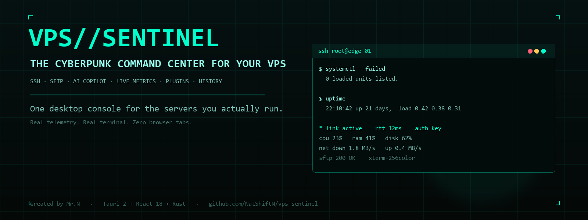

<p align="center">
  
</p>

<h1 align="center">VPS//SENTINEL</h1>

<p align="center">
  <b>一台真正属于 VPS 运维者的赛博朋克桌面控制台。</b><br />
  真终端、真遥测、SFTP、AI 助手、插件系统。不用再开一堆浏览器标签。
</p>

<p align="center">
  <a href="README.md">English</a> ·
  <a href="README.zh-CN.md">简体中文</a>
</p>

<p align="center">
  
  
  
  
  
  <a href="https://github.com/NatShiftN/vps-sentinel/actions/workflows/ci.yml"></a>
</p>

<p align="center">
  <a href="https://github.com/NatShiftN/vps-sentinel/releases/latest"><b>⬇ 下载 Windows 版</b></a>
  &nbsp;·&nbsp;
  <a href="#产品一览">产品一览</a>
  &nbsp;·&nbsp;
  <a href="#功能">功能</a>
  &nbsp;·&nbsp;
  <a href="#从源码构建">从源码构建</a>
</p>

---

## 为什么需要它

VPS 的日常操作通常散落在：SSH 终端、`~/.ssh/config`、SFTP 客户端、监控面板、笔记和 AI 网页之间。VPS//SENTINEL 把它们收进一个桌面窗口：

> **连接 → 看状态 → 在终端干活 → 传文件 → 排查 → 问 AI → 留下记录。**

它首先是一个真正的 SSH 控制台，其次才是一个赛博朋克控制室。遥测不是假数据，终端不是模拟器，中间也没有浏览器壳。

### 适合谁

- 想要 **SSH + 文件 + 转发 + 健康状态**放在一个窗口的 VPS / Homelab 玩家。
- 需要快速判断 **CPU / 内存 / 磁盘 / 延迟**的开发者与值班运维。
- 喜欢终端、键盘操作和暗色控制台的人。
- 希望工具完全在本地、可检查、可自己构建的人。

---

## 产品一览

> **隐私说明：** 公开 README 特意不附带真实机器截图。截图可能暴露主机名、CPU 型号、磁盘、IP、host key 和终端内容。需要图库时，请连接演示主机并自行打码后再发布。

| 界面 | 你能得到什么 |
| --- | --- |
| **控制中心** | 本地 / 远端遥测、链路健康、延迟与真实 xterm 终端在同一个窗口。 |
| **SSH 工作台** | 标签、分屏、同步输入、终端搜索、主机管理与密钥管理。 |
| **服务器视图** | CPU、内存、磁盘、网络、load、kernel、uptime 与 SSH RTT。 |
| **文件与隧道** | SFTP 原生另存为、下载历史、本地/远程端口转发。 |
| **记忆** | SQLite 会话历史、命令搜索、审计记录与回放。 |
| **扩展** | AI 助手、安全审计、主题、声明式插件、屏幕保护与双语界面。 |

---

## 功能

### 真终端

- 基于 **xterm.js + SSH PTY** 的真实终端（vim、htop、less、颜色、滚动回看）。
- 多标签、**双栏分屏**、**多会话同步输入**。
- **Ctrl+F** 终端搜索，上一个 / 下一个匹配。
- 复制粘贴、字体大小、主题调色板、选中文本交给 AI。

### SSH 工作台

- 密码、私钥、**ssh-agent** 认证。
- **ProxyJump**（密码跳板机）与 host key 固定。
- **Host Manager**：保存主机、分组、私钥路径、一键连接。
- **导入 `~/.ssh/config`**（HostName / User / Port / IdentityFile）。
- **SSH 密钥管理**：列出密钥、复制公钥、生成 Ed25519、删除。
- **本地 / 远程端口转发**（远程需要服务端支持 `tcpip-forward`）。
- **X11 / agent forwarding**：通过系统 OpenSSH + ConPTY 独立会话（`-X -A`）。

### 服务器状态与 SSH 健康

- 远端 **CPU 使用率**、**内存**、**磁盘**、**实时网络**、load、kernel、uptime。
- **SSH 延迟**每 5 秒探测，带 sparkline。
- 连接健康：`healthy` / `degraded` / `lost` / `handshake`。
- 会话时长、收发字节、空闲时间、keepalive、重连次数。
- 掉线自动重连（退避）。

### 文件与转发

- SFTP 上传、下载、重命名、新建目录、删除。
- 原生 **另存为** 对话框，可设置默认下载目录。
- 下载记录、完成状态、打开所在位置。
- 文件行 `⋯` 菜单：下载 / 重命名 / 删除 / 复制路径。

### AI 助手与安全审计

- OpenAI-compatible AI 助手，支持终端上下文与命令插入。
- API Key 存入系统 keychain，不进入仓库或插件文件。
- 只读安全审计：SSH 配置、监听端口/防火墙、补丁、暴露面。

### 个性化

- 内置 **主题 / 布局市场**（声明式 JSON，不含代码）。
- **插件中心**：命令片段、AI 提示词、提供方预设。
- 只支持本地声明式插件，不执行第三方代码。
- 无边框窗口、界面缩放 85–125%、终端字号 11–18px。
- 一键全屏**屏幕保护**，带时钟与隐私遮罩。

### 历史与隐私

- SQLite 会话历史：终端输出、可选命令捕获、审计记录。
- 跨 session 搜索与**命令历史搜索**。
- **回放**终端输出，支持暂停 / 加速。
- 命令捕获**默认关闭**；历史保存在本地且未加密。
- 保留天数 1–90 天可配置。

### 多语言

应用内置 **English** 与 **简体中文**，按系统语言自动选择，可在 **Settings → Language** 切换。README 也提供两种语言。

---

## 安装（Windows 便携版）

1. 从 [Releases](https://github.com/NatShiftN/vps-sentinel/releases/latest) 下载最新的 `VPS-SENTINEL-*-win64.zip`。
2. 解压 ZIP。
3. 确保这两个文件在**同一目录**：
   - `VPS-SENTINEL.exe`
   - `WebView2Loader.dll`
4. 双击 `VPS-SENTINEL.exe`。

要求：

- Windows 10 / 11 x64
- Microsoft Edge **WebView2 Runtime**（通常系统已自带）
- 无需安装，不写注册表
- 构建**未签名**，SmartScreen 可能提示

### X11 / agent forwarding 前提

- Windows **OpenSSH Client**（`C:\Windows\System32\OpenSSH\ssh.exe`）。
- X11：本机 X Server，例如 **VcXsrv** 或 **X410**。
- Agent forwarding：本机 SSH agent（Windows OpenSSH Agent 或 Pageant）。
- 在 **Host Manager → X11/A** 启动带 `-X -A` 的独立 ConPTY 会话。

> X11/agent 使用**系统 OpenSSH**，使用它自己的 `known_hosts`，与原生 ssh2 会话的 SFTP / metrics / history 不共享。

---

## 从源码构建

### 要求

- Node.js **20+**
- Rust **stable**
- Windows：Visual Studio Build Tools（**MSVC + Windows SDK**，推荐）、WebView2 Runtime
- Linux：WebKitGTK 4.1、GTK 3、OpenSSL、`pkg-config`

```bash
npm ci
npm test
npm run build
npm run tauri build
```

本项目使用的便携 GNU 构建：

```powershell
npm run build
cd src-tauri
cargo build --release --features custom-protocol
```

把 `WebView2Loader.dll` 复制到 exe 同目录。

### 目录结构

```text
src/                 React UI、终端、设置、插件
src-tauri/          Rust 后端：SSH、SFTP、遥测、SQLite、ConPTY
public/             字体与静态资源
docs/banner.png     README 横幅
```

### 架构

```text
┌──────────────────────────────┐
│ React + xterm.js             │
│ 标签 · 设置 · 插件           │
└──────────────┬───────────────┘
               │ Tauri IPC / events
┌──────────────▼───────────────┐
│ Rust 后端                    │
│ ssh2 · sysinfo · rusqlite    │
│ portable-pty · rfd · keyring │
└──────────────┬───────────────┘
               │ SSH / SFTP / system ssh
          ┌────▼────┐
          │  VPS    │
          └─────────┘
```

---

## 安全与隐私

- 应用本身**不发送遥测**。
- SSH 密码/passphrase 只存在内存，不落盘。
- AI API Key 存入系统 keychain（可用时）。
- 终端历史是**本地 SQLite，未加密**；请按敏感数据对待。
- 命令捕获**默认关闭**，因为可能捕获 sudo/密码提示处输入的内容。
- 主题和插件都是**声明式 JSON**，不含 JS/HTML/CSS 或可执行插件代码。
- X11/agent 独立会话使用系统 OpenSSH 及其 host-key 存储。
- 仓库不包含任何预置 API Key 或凭据。

---

## 已知限制

- 目前只提供 Windows 便携版，Linux/macOS 未打包。
- 未做代码签名，SmartScreen 会提示。
- X11/agent forwarding 依赖外部 X Server / SSH agent，且是独立 OpenSSH 会话。
- 远程端口转发依赖服务端 `tcpip-forward`。
- 分屏是两个标签并排，不是任意数量 pane。
- 历史未加密；命令捕获默认保守关闭。
- 没有云同步、中央面板或托管账号。

Roadmap：签名安装包、macOS/Linux、可选加密历史、更多终端布局、远程转发真机测试矩阵。

---

## 参与贡献

欢迎 Issue 和 PR。

```bash
npm ci
npm test
npm run build
cargo test --manifest-path src-tauri/Cargo.toml
```

请勿提交测试凭据、私钥、本地历史数据库或 `ai_config.json`。

---

## License

[MIT](LICENSE) © 2026 **Mr.N**

<p align="center">
  <sub>Built with Tauri 2, React 18, Rust, xterm.js and a lot of phosphor green.</sub><br />
  <sub>如果它对你有用，点一个 ⭐ 能让更多 VPS 玩家看到它。</sub>
</p>
